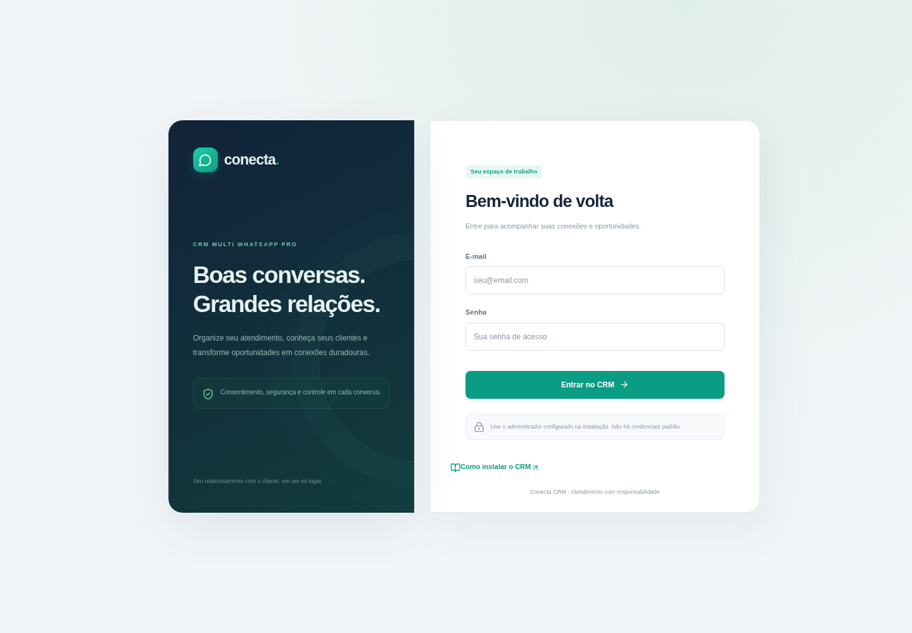
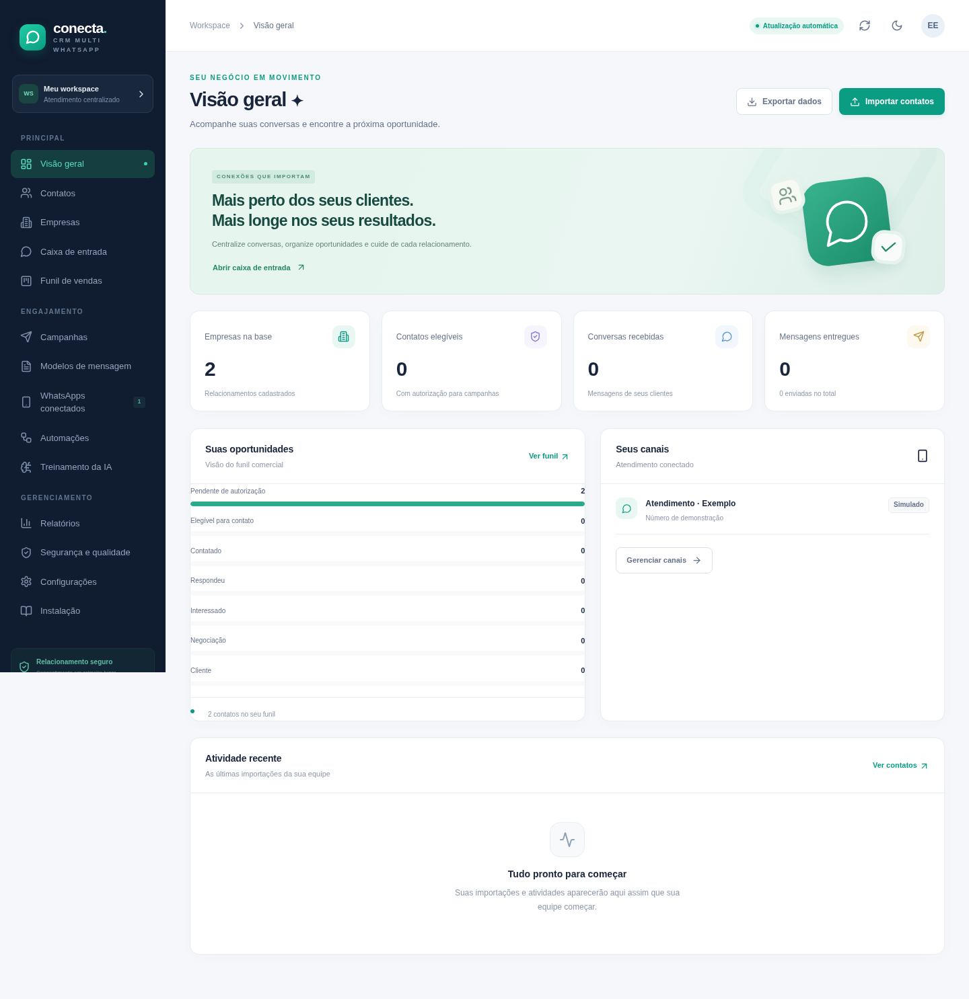
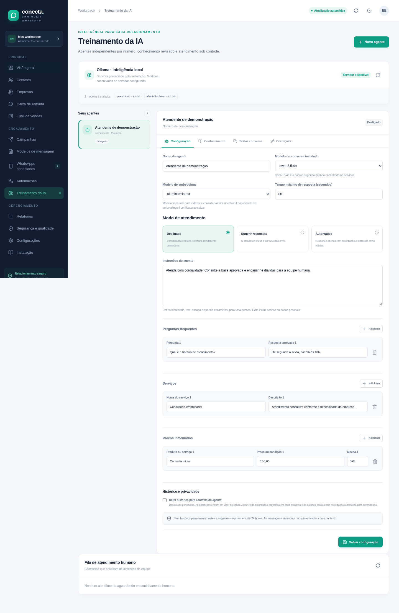

# Tutorial de instalação do Conecta CRM

Escolha o seu sistema e siga os comandos na pasta do projeto. O CRM inclui aplicação web, worker, PostgreSQL com pgvector e Redis. Ollama é opcional.

- [Windows 11](#windows-11)
- [Linux](#linux)
- [TrueNAS SCALE](#truenas-scale)
- [macOS](#macos)
- [Primeiro acesso e conferência](#primeiro-acesso-e-conferência)
- [Ollama opcional](#ollama-opcional)
- [Problemas comuns](#problemas-comuns)

Código: https://github.com/mikaelzapp/crm. Como alternativa ao Git, baixe o [ZIP da branch main](https://github.com/mikaelzapp/crm/archive/refs/heads/main.zip), extraia a pasta inteira e abra o terminal nela. Preserve os arquivos iniciados por ponto, incluindo `.env.example`. Se o repositório for privado, utilize uma conta com acesso ao GitHub.

As imagens deste guia são **capturas da interface do CRM com dados fictícios**. Elas orientam o uso do produto e não representam telas dos instaladores de Windows, Docker ou TrueNAS.

Planeje **8 GB de RAM para CRM e serviços** e espaço para imagens, banco e backups. Para um modelo de IA de 4B, prefira **16 GB ou mais**; consumo e velocidade dependem do modelo, quantização, contexto e hardware. Não é necessário instalar Node, PostgreSQL ou Redis separadamente para seguir o fluxo Docker abaixo.

## Windows 11

### 1. Preparar o Docker Desktop

Instale o [Docker Desktop para Windows](https://docs.docker.com/desktop/setup/install/windows-install/) com WSL2 e virtualização habilitados. Use contêineres Linux e aguarde o Docker iniciar. No PowerShell:

```powershell
docker --version
docker compose version
```

### 2. Baixar e abrir o projeto

Com Git para Windows instalado:

```powershell
git clone https://github.com/mikaelzapp/crm.git
Set-Location .\crm
```

Se você usou o ZIP, abra o PowerShell na pasta extraída que contém `docker-compose.yml` e `instalar.bat`.

### 3. Instalar

```powershell
.\instalar.bat
```

O script gera `.env` com segredos aleatórios somente se o arquivo não existir, preserva uma configuração anterior e inicia a construção dos serviços. A primeira execução precisa de internet. Mantenha o Docker Desktop aberto.

Se o PowerShell bloquear `configure.ps1` por ter vindo de um download, leia o helper e desbloqueie apenas esse arquivo. A política abaixo vale para a sessão atual; não altera a configuração global:

```powershell
Get-Content .\scripts\configure.ps1
Unblock-File .\scripts\configure.ps1
Set-ExecutionPolicy -Scope Process -ExecutionPolicy RemoteSigned
.\instalar.bat
```

Uma política corporativa pode impedir essa mudança. Nesse caso, siga o procedimento autorizado para o computador.

### 4. Conferir e retomar

```powershell
docker compose ps
```

Aguarde `web` saudável e continue em [Primeiro acesso](#primeiro-acesso-e-conferência). Nas próximas vezes, inicie o Docker Desktop e execute:

```powershell
.\iniciar.bat
```

## Linux

### 1. Conferir Docker e Compose

Instale Docker Engine e o plugin Compose v2 pela [documentação oficial da sua distribuição](https://docs.docker.com/engine/install/). O usuário precisa de acesso autorizado ao daemon Docker.

```bash
docker --version
docker compose version
```

Este tutorial não instala pacotes do sistema por scripts remotos.

### 2. Baixar o projeto

```bash
git clone https://github.com/mikaelzapp/crm.git
cd crm
```

### 3. Gerar `.env` sem Node no host

Execute dentro da pasta `crm`:

```bash
docker run --rm --user "$(id -u):$(id -g)" \
  -v "$PWD:/app" -w /app \
  node:22-bookworm-slim node scripts/generate-env.mjs
```

O contêiner temporário usa seu UID/GID. Assim, o `.env` criado com permissão restrita continua legível pelo seu usuário. Nenhum segredo é impresso e um `.env` existente não é sobrescrito.

### 4. Construir e iniciar

```bash
docker compose config --quiet
docker compose up -d --build
docker compose ps
```

Aguarde `web` saudável e continue em [Primeiro acesso](#primeiro-acesso-e-conferência). Para retomar sem reconstruir:

```bash
docker compose up -d
```

O vínculo padrão é `127.0.0.1:3000`. Se o Linux for um servidor remoto, configure a origem real em `APP_URL` e um vínculo de rede ou proxy reverso adequado; `localhost` no seu navegador aponta para o computador em que o navegador está aberto.

## TrueNAS SCALE

### 1. Preparar o dataset e a versão

Use TrueNAS SCALE **24.10 ou posterior**, com backend Docker/Apps e Compose disponível. Confira a [documentação da sua versão](https://www.truenas.com/docs/scale/). O fluxo deste tutorial usa o Shell com Compose disponível.

Crie previamente o dataset pela interface de armazenamento e confira as ACLs do operador. Não instale Docker ou pacotes do sistema com `apt` no appliance. Se Git não estiver disponível, extraia o ZIP em outro computador e copie a pasta completa por SMB/SFTP autorizado, preservando os arquivos iniciados por ponto.

```bash
docker --version
docker compose version
```

### 2. Baixar o projeto no dataset real

**Substitua `SEU_POOL` e `apps` pelo caminho do seu pool e dataset antes de executar.** O caminho abaixo é ilustrativo, não uma pasta que deva ser criada literalmente.

```bash
cd /mnt/SEU_POOL/apps
git clone https://github.com/mikaelzapp/crm.git
cd crm
```

### 3. Gerar `.env`

```bash
docker run --rm --user "$(id -u):$(id -g)" \
  -v "$PWD:/app" -w /app \
  node:22-bookworm-slim node scripts/generate-env.mjs
```

Abra `.env` em editor e ajuste as linhas abaixo. **Isto é um trecho do arquivo, não um comando de terminal.** Substitua `IP_DO_TRUENAS` pelo endereço real:

```dotenv
BIND_ADDRESS=0.0.0.0
APP_URL=http://IP_DO_TRUENAS:3000
```

O exemplo é para uma rede local confiável. Para acesso público e webhook da Meta, use proxy reverso com certificado HTTPS e a origem correspondente em `APP_URL`. Preserve os demais valores, especialmente credenciais e `ENCRYPTION_KEY`.

### 4. Iniciar e preservar os dados

```bash
docker compose config --quiet
docker compose up -d --build
docker compose ps
```

Acesse a origem configurada em `APP_URL` e siga [Primeiro acesso](#primeiro-acesso-e-conferência).

O projeto Compose se chama `crm-whatsapp`. Preserve esse nome e os volumes ao atualizar. Se substituir volumes por datasets bind-mounted, ajuste permissões para os usuários efetivos das imagens. Não modifique manualmente um datadir PostgreSQL vivo.

A opção de aplicativo personalizado por YAML do TrueNAS varia conforme a versão e pode exigir uma imagem pré-construída em registro. O `docker-compose.yml` deste repositório contém `build:`; colar somente esse YAML na interface não garante a construção da imagem. Use uma imagem pré-construída quando sua versão exigir. Este guia usa o fluxo Shell/Compose.

## macOS

### 1. Preparar o Docker Desktop

Instale a edição do [Docker Desktop para macOS](https://docs.docker.com/desktop/setup/install/mac-install/) apropriada ao Mac Intel ou Apple Silicon e aguarde o runtime iniciar. No Terminal:

```bash
docker --version
docker compose version
```

As imagens padrão usam a plataforma detectada pelo Docker. Não é necessário forçar `linux/amd64` no fluxo normal.

### 2. Baixar o CRM

```bash
git clone https://github.com/mikaelzapp/crm.git
cd crm
```

Você também pode usar o ZIP e abrir o Terminal na pasta extraída.

### 3. Gerar `.env` com seu usuário

```bash
docker run --rm --user "$(id -u):$(id -g)" \
  -v "$PWD:/app" -w /app \
  node:22-bookworm-slim node scripts/generate-env.mjs
```

Não é necessário instalar Node no macOS. O helper preserva um arquivo `.env` existente e mantém o novo arquivo legível pelo seu usuário.

### 4. Construir e iniciar

```bash
docker compose config --quiet
docker compose up -d --build
docker compose ps
```

Aguarde `web` saudável e siga [Primeiro acesso](#primeiro-acesso-e-conferência). Mantenha Docker Desktop aberto enquanto utilizar o CRM.

## Primeiro acesso e conferência

No mesmo computador, abra `http://localhost:3000`. No TrueNAS ou servidor de rede, use a origem real configurada em `APP_URL`.

Abra `.env` **em um editor local**, consulte `ADMIN_EMAIL` e `ADMIN_PASSWORD` e entre no CRM. Não envie esse arquivo para o GitHub nem publique seu conteúdo. O gerador cria senhas aleatórias; não há uma senha padrão fixa.



*Captura da interface do CRM; use suas próprias credenciais.*

O serviço `web` aplica migrations e prepara o primeiro administrador antes de iniciar. O seed preserva contas existentes: editar `ADMIN_PASSWORD` depois não redefine a senha de uma conta já criada. Use a funcionalidade de alteração de senha do CRM após entrar.

Confira o dashboard e importe seu CSV pela interface. As mensagens importadas permanecem como rascunho e contatos começam pendentes de autorização. Importar dados não inicia envios.



*Captura com dados fictícios. Os números exibidos não são uma promessa de resultados nem os dados da sua instalação.*

A integração real da Meta depende de credenciais oficiais, números empresariais e webhook público HTTPS. Consulte [Configuração da Meta](meta.md). Números `MOCK` servem somente para testes.

## Ollama opcional

O CRM funciona com agentes desligados. Para Ollama no Compose, faça o download dos modelos explicitamente:

```bash
docker compose --profile ollama up -d ollama
docker compose exec -e OLLAMA_HOST=http://127.0.0.1:11434 ollama ollama pull qwen3.5:4b
docker compose exec -e OLLAMA_HOST=http://127.0.0.1:11434 ollama ollama pull all-minilm
docker compose exec -e OLLAMA_HOST=http://127.0.0.1:11434 ollama ollama list
```

Os mesmos comandos `docker compose` podem ser usados no PowerShell. Não há download automático de pesos no boot.

Em **Treinamento da IA**, crie um agente por conexão e escolha um modelo de conversa e um modelo de embeddings que estejam instalados. Teste com dados sintéticos antes de habilitar sugestões ou modo automático. Documentos, textos e correções aprovadas formam uma base RAG; esse fluxo não altera os pesos do modelo.



*Captura com dados fictícios. A lista real depende dos modelos instalados no seu servidor.*

URLs corretas:

| Situação | Configuração |
| --- | --- |
| Ollama e CRM no Compose | `OLLAMA_DOCKER_BASE_URL=http://ollama:11434` |
| Ollama no host, CRM em Docker Desktop | `OLLAMA_DOCKER_BASE_URL=http://host.docker.internal:11434` |
| Next e worker executados diretamente no host | `OLLAMA_BASE_URL=http://127.0.0.1:11434` |

Ollama precisa escutar numa interface alcançável pelo cliente. A API fica na rede Docker, sem publicação de porta por padrão. Não a exponha diretamente à internet. Em redes restritas, autorize os registros e destinos de distribuição efetivamente usados; erros de política não devem ser contornados desligando TLS.

A permissão para processamento de IA é explícita por conversa e não substitui o consentimento para comunicação. Consulte [Ollama, RAG e privacidade](ollama.md) para recursos, modelos, documentos e limites.

## Retomar, atualizar e fazer backup

Na mesma pasta do projeto:

```bash
docker compose up -d
docker compose ps
```

No Windows, você também pode usar `iniciar.bat`. Preserve o nome do projeto `crm-whatsapp`, os volumes e a chave `ENCRYPTION_KEY`. Faça backup antes de atualizar o código ou trocar imagens.

O [guia de segurança](seguranca.md) explica backup e restauração. `scripts/backup.sh` usa `pg_dump`; a restauração substitui dados e deve ser ensaiada em ambiente separado. No Windows, esses scripts de shell podem ser executados em um ambiente compatível, como WSL, com acesso ao mesmo Docker.

Não remova volumes para tentar corrigir uma instalação. Não copie um datadir PostgreSQL vivo como se fosse um backup lógico consistente.

## Problemas comuns

**Docker não responde ou mostra permissão negada:** inicie Docker Desktop/serviço Docker e confirme o acesso autorizado do usuário. No TrueNAS, use os mecanismos suportados do appliance. Não dê permissão pública ao socket Docker.

**Porta 3000 ocupada:** edite o arquivo `.env` para usar uma porta livre e a mesma origem em `APP_URL`. Exemplo para o computador local:

```dotenv
PORT=3001
APP_URL=http://localhost:3001
```

Recrie os serviços com `docker compose up -d`. Para servidor de rede, use o host/IP real em `APP_URL`.

**Web ainda não ficou saudável:** examine o estado e os logs; revise informações sensíveis antes de compartilhar a saída:

```bash
docker compose ps
docker compose logs --tail=80 web worker
```

**Ollama disponível com lista vazia:** instale um modelo e execute `ollama list` conforme os comandos acima. Servidor saudável não comprova que os pesos estejam presentes nem que uma inferência real tenha sido validada.

**Senha deixou de funcionar após editar `.env`:** o seed não redefine uma conta existente. A senha da conta é mantida no banco. Use o procedimento de alteração de senha ou recuperação administrativa da instalação, preservando os dados.

## O que foi validado

O gerador POSIX foi exercitado em contêiner Node 22 com UID/GID do host: criou `.env` legível pelo usuário e a segunda execução preservou o arquivo byte a byte. A configuração Compose foi validada. A aplicação e seus serviços foram construídos e testados na nuvem.

Windows, macOS e TrueNAS não foram executados nesta máquina. As instruções seguem os mecanismos descritos para cada plataforma; confirme os pré-requisitos e permissões no equipamento de destino. Consulte [Validação](validacao.md) para as evidências dos testes do CRM e a distinção entre APIs reais e testes simulados.
